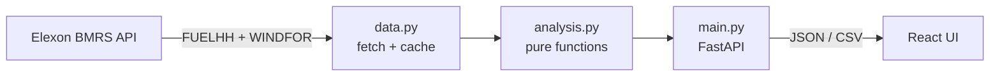

# UK Wind Forecast Analyser

A web application for a UK energy utility's **day-ahead power-buying desk**. It answers two questions:

1. **What is the latest wind-generation forecast available at the moment I must decide?**
2. **How accurate are those forecasts, in numbers, so I can size a safety margin?**

Data source: [Elexon BMRS](https://bmrs.elexon.co.uk) only. Actual wind from `FUELHH` (`fuelType=WIND`), forecasts from `WINDFOR`. Scope: purchase decisions made in **January 2026** (delivery days 2 Jan – 1 Feb 2026), national level.

> **Live app (Render):** https://your-app.onrender.com

> **AI disclosure:** AI tools (Anthropic Claude) were used to help design and write this code. All code was reviewed, run and tested by the me.

---

## Table of contents

[Features](#features) · [Quick start](#quick-start) · [Local development](#local-development) · [Testing](#testing) · [How it works](#how-it-works) · [API](#api-reference) · [Configuration](#configuration) · [Deploy](#deployment-render) · [Project structure](#project-structure) · [Limitations](#known-limitations--roadmap)

## Features

| Requirement                                               | Where in the app                                                                                                                                                                                |
| --------------------------------------------------------- | ----------------------------------------------------------------------------------------------------------------------------------------------------------------------------------------------- |
| Understand the latest forecast available at decision time | **Forecast** tab: forecast for a chosen delivery day exactly as known at the D-1 cutoff, forecast age, number of forecast versions seen, comparison with actuals, half-hourly table, CSV export |
| Evaluate forecast accuracy quantitatively                 | **Accuracy** tab: MAE, RMSE, bias, MAPE, 5th/95th percentile errors; by day, by hour of day, by forecast lead time; day-ahead vs 4-hours-ahead; hardest days; CSV export                        |
| Decide using the quantified error                         | Risk slider (P50–P99) turns historical error into a MW safety buffer and a "cautious wind" figure                                                                                               |
| Trust the data                                            | **Data quality** tab: automatic completeness and no-look-ahead checks                                                                                                                           |
| Understand every number                                   | Info (ℹ) tooltips, plain-English summaries, **Guide & glossary** tab                                                                                                                            |

## Quick start

Requires [Docker Desktop](https://www.docker.com/products/docker-desktop) (running) and Git.

```bash
git clone <this-repo-url>
cd <repo-folder>
docker compose up --build
```

Open **http://localhost:8000**. On first start the app downloads January 2026 data from Elexon (~1 minute; the page shows a loading message). Stop with `Ctrl+C`; start again with `docker compose up`.

## Local development

Needs Python 3.12+ and Node 20+. Two terminals:

```bash
# Terminal 1 - backend (http://localhost:8000)
cd backend
python -m venv venv
venv\Scripts\activate          # macOS/Linux: source venv/bin/activate
pip install -r requirements.txt
uvicorn app.main:app --reload

# Terminal 2 - frontend (http://localhost:5173, proxies /api to :8000)
cd frontend
npm install
npm run dev
```

## Testing

```bash
cd backend
python -m pytest -q                                   # unit + API tests (offline, synthetic data)
RUN_LIVE=1 python -m pytest tests/test_live_api.py -v # live tests against the real Elexon API
python check_data.py                                  # prints a data sanity report
```

PowerShell: `$env:RUN_LIVE="1"`. Via Docker: `docker compose run --rm -e RUN_LIVE=1 app python -m pytest tests -v`.

- **Unit tests** build tiny datasets with known answers (e.g. forecast exactly 100 MW above actual must give MAE = 100 and bias = +100) and check that forecasts published after the cutoff are never used.
- **API tests** exercise every endpoint with synthetic data.
- **Live tests** verify the real API: 48 half-hours per day of wind actuals, required forecast fields, complete month, no missing values.
- GitHub Actions (`.github/workflows/ci.yml`) runs the offline tests and the frontend build on every push.

## How it works



**Decision-time snapshot (the core idea).** For delivery day _D_, the buying decision is made on _D-1_ at a cutoff hour (default 09:00 London). The app keeps only forecasts with `publishTime <= cutoff`, then takes the latest one per `startTime`. Using the newest forecast overall would leak information the desk did not have.

**Error convention.** `error = forecast − actual`. Positive means wind was over-forecast, which is the risky direction for a buyer (too little thermal power bought).

**Safety buffer.** The chosen percentile (default P95) of past over-forecasts, computed **only from days before the delivery day** (no look-ahead). Cautious wind = forecast − buffer.

**Assumptions** (change in the UI where noted):

- Cutoff defaults to 09:00 London on D-1 (adjustable). Confirm against your market's real gate closure.
- January 2026 decisions are for delivery days 2 Jan – 1 Feb.
- Forecasts published after the half-hour they predict (negative lead time) exist in the raw data. They can never inform a day-ahead decision, so they are excluded from decision-time and lead-time analysis. The Data quality tab reports how many there are.
- Demand is out of scope (brief limits data to Elexon wind), so the app shows wind and its risk, not total residual demand.

## API reference

| Endpoint                                           | Description                                                       |
| -------------------------------------------------- | ----------------------------------------------------------------- |
| `GET /api/health`                                  | `{ready, error}`: whether Elexon data has loaded                  |
| `GET /api/days`                                    | Valid delivery days                                               |
| `GET /api/forecast?date=&cutoff_hour=&percentile=` | Decision-time forecast, actuals, risk band, summary               |
| `GET /api/accuracy?cutoff_hour=`                   | Overall, daily, hourly, lead-time metrics, worst days, comparison |
| `GET /api/data-quality?cutoff_hour=`               | Data completeness and integrity checks                            |
| `GET /api/forecast.csv`, `GET /api/accuracy.csv`   | CSV exports                                                       |

Interactive docs: `/docs` (FastAPI Swagger UI).

## Configuration

| Variable     | Default                             | Purpose                                 |
| ------------ | ----------------------------------- | --------------------------------------- |
| `PORT`       | `8000`                              | HTTP port (set automatically on Render) |
| `CACHE_FILE` | system temp dir `/elexon_cache.pkl` | Where downloaded data is cached         |

## Deployment (Render)

The app is deployed on [Render](https://render.com) as a Docker web service, built directly from the root `Dockerfile` (no extra configuration or environment variables).

1. Push the repo to GitHub.
2. On Render: **New + → Web Service →** select the repo → Language **Docker** → Instance type **Free** → set Health Check Path to `/api/health` → **Create Web Service**.

**Note on hosting choice:** the free Render plan puts the service to sleep after inactivity, so a scheduled GitHub Action (`.github/workflows/keep-alive.yml`) pings `/api/health` every 10 minutes. The first request after a restart can still take up to a minute while data loads from Elexon. The app is plain Docker, so it also runs on Heroku or any other container host.

## Project structure

```
.
├── backend/
│   ├── app/
│   │   ├── data.py          # Elexon client (chunked requests) + disk cache
│   │   ├── analysis.py      # Snapshot selection, metrics, lead-time analysis (pure functions)
│   │   └── main.py          # FastAPI routes; serves the built React app
│   ├── tests/               # unit, API and live tests
│   ├── check_data.py        # data sanity report
│   └── requirements.txt
├── frontend/                # React + Vite + Recharts
│   ├── src/App.jsx
│   └── public/favicon.svg
├── .github/workflows/ci.yml # CI
├── Dockerfile               # multi-stage: build React, run FastAPI
├── docker-compose.yml
└── README.md
```

## Known limitations & roadmap

- One month of data; cache is on local disk and is lost on restart (next: persistent store + scheduled refresh).
- No authentication or rate limiting.
- Next: demand data for residual power to buy, solar forecasts, alerts when forecasts shift sharply.
